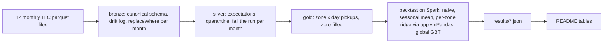

# demand-lakehouse

Demand forecasting for hundreds of location-day series on a local **Spark + Delta Lake** lakehouse: a medallion
pipeline (bronze, silver, gold) over 46.5 million public NYC taxi trips, data-quality expectations that can stop a
run, and a rolling-origin backtest of four forecasting methods across a zone, borough and city hierarchy.

A personal portfolio project. Built with Claude Code as a pair programmer.

## Problem

Pricing and supply teams in travel and mobility forecast demand for thousands of location-day series: zones,
properties, routes. One series in a notebook is easy. The hard parts are around the model: monthly raw files whose
schema drifts, bad rows that must not reach the model, a hierarchy whose forecasts should add up, and a backtest that
never peeks at the future. Get those wrong and the forecast is confidently wrong, and the price or the fleet plan built
on it is too.

## Approach



- **Data**: NYC TLC yellow-taxi trip records, Oct 2025 to Sep 2026 (public), and the TLC taxi-zone lookup.
  Demand = pickups per zone per day: 263 zones, 6 boroughs, 1 city, 365 days.
- **Bronze** (`bronze.py`): each monthly file is mapped to a canonical schema on its own; casts, renamed columns and
  new columns are logged as drift. A month is written with Delta `replaceWhere`, so a rerun replaces it, never
  duplicates it.
- **Silver** (`silver.py`): rules describe a good row. Drop rules send failing rows to a quarantine table; if any
  month's failure rate passes the rule's threshold, the run stops. Warn rules only count. The same idea as Delta Live
  Tables' `expect`, `expect_or_drop` and `expect_or_fail`.
- **Gold** (`gold.py`): pickups per zone per day, zero-filled, so a quiet day is a 0, not a missing row.
- **Forecasting** (`forecast.py`), all on Spark. A row is (series, origin, horizon); features come only from days up
  to the origin (tested in `tests/test_forecast.py`).
  - `seasonal_naive`: the last value on the same weekday. `seasonal_mean4`: the mean of the last four.
  - `ridge_per_series`: one small ridge regression per series, trained in parallel with `groupBy().applyInPandas()`
    (the "many models" pattern).
  - `gbt_global`: one Spark MLlib gradient-boosted tree model for every series at a level. Its target is the log
    ratio of demand to the series' 28-day level, chosen over a plain log target on a separate validation window
    (`results/model_selection.json`) before the test window was scored.
  - Hierarchy: zone forecasts summed to borough and city (bottom-up) against direct forecasts at those levels.
- **Orchestration**: `jobs.yaml` is the task graph (field names follow a Databricks job definition) and
  `runner.py` runs it in dependency order with retries and a run log (`results/run.json`).
- **Eval gate in CI**: the backtest is replayed on Spark from the committed gold snapshot
  (`data/gold/zone_day.parquet`, 96k rows); it must reproduce `results/backtest.json` and keep beating
  seasonal-naive on zone-level MASE.

## Results

Every number below is generated from `results/*.json` by `python -m demand_lakehouse report`.

<!-- results:start -->
<!-- results:end -->

### What the numbers say

- **The data-quality gate caught a real problem.** The first version of the amounts rule ("fare and total are not
  negative") stopped the run: in Nov 2025, 9.4% of rows had a negative fare. `python -m demand_lakehouse investigate`
  (`results/negative_fares.json`) showed two different things. Negative rows paid by card, cash, no-charge or dispute
  are mostly exact mirrors of a positive trip in the same file: reversals, rightly dropped. Negative rows with payment
  type 0 (flex fare) had no mirror at all (0 of 346,979 in Nov 2025) and a normal median distance: real pickups with
  a bad amount. Dropping them would have cut 8.3% of November's trips. The rule now drops reversals and only counts the
  flex-fare rows.
- **Seasonal-naive is a strong baseline for taxi demand.** On the summer test window the global GBT beats it on
  volume-weighted error only slightly, and by more on per-zone scaled error (MASE), which means it helps the small,
  noisy zones more than the big ones.
- **A plain log target does not work for one global tree model.** Trees cannot extrapolate levels; a model that
  predicts demand relative to each series' recent level can serve a 3-trip zone and the whole city.
- **At the top of the hierarchy, summing zone forecasts beats a direct tree model.** A borough or city model has 6
  or 1 series to learn from; the zone model learns from 263.

## Run it

```bash
# Java 17+ (Spark 4): e.g. brew install openjdk@21 && export JAVA_HOME=/opt/homebrew/opt/openjdk@21
uv sync
uv run python -m demand_lakehouse download        # 12 files, ~780 MB, into data/raw/
uv run python -m demand_lakehouse run             # bronze -> silver -> gold -> backtest -> report (about 8 min on an M2)
uv run python -m demand_lakehouse select          # GBT target choice on the validation window
uv run python -m demand_lakehouse investigate     # the negative-fare investigation
uv run python -m demand_lakehouse scaling         # stage times by cores and shuffle partitions
uv run python -m demand_lakehouse ci              # the eval gate: replay from the gold snapshot (no download)
uv run pytest -q
```

## Mapping to Databricks

Nothing here ran on Databricks; this is how the pieces would map. The bronze, silver and gold tables are Delta tables,
so they become Unity Catalog tables. The silver rules become Delta Live Tables expectations (`expect_or_drop`, with
`expect_or_fail` for the monthly thresholds). `jobs.yaml` becomes a Databricks job with one task per key. The
`applyInPandas` many-models step and the MLlib model run unchanged on a cluster; MLflow would track the GBT runs
and the chosen target variant.

## Limitations

- One laptop in local mode, not a cluster: the scaling table is cores on one machine, and Spark's value here is the
  pattern more than the speed. Gold is small (96k rows); Spark earns its keep in bronze and silver (46.5M rows).
- Taxi pickups are a proxy for travel demand, not bookings or prices; there is no price signal to optimise.
- One test window (12 weekly origins, Jul to Sep 2026) and one validation window (Apr to Jul 2026). Summer and the
  4 July holiday are in the test window; results on a winter window could differ.
- The GBT is trained once at the first test origin, not refit at every origin.
- The holiday list is hard-coded US federal holidays plus a few days around Thanksgiving and Christmas; no events,
  weather or airport schedules.
- The validation window chose the GBT target; GBT hyperparameters were not tuned.

## Next steps

- Refit at each origin and add weather and event features (the obvious source of the remaining error).
- Reconcile the hierarchy properly (MinT) instead of bottom-up only.
- Prediction intervals (quantile GBT or conformal) so a pricing team sees the risk, not just the point.
- Run the same job on a multi-node cluster and measure shuffle cost as zones x days grows.

## Data and licence

NYC TLC trip records are published by the NYC Taxi and Limousine Commission. Code: MIT.
